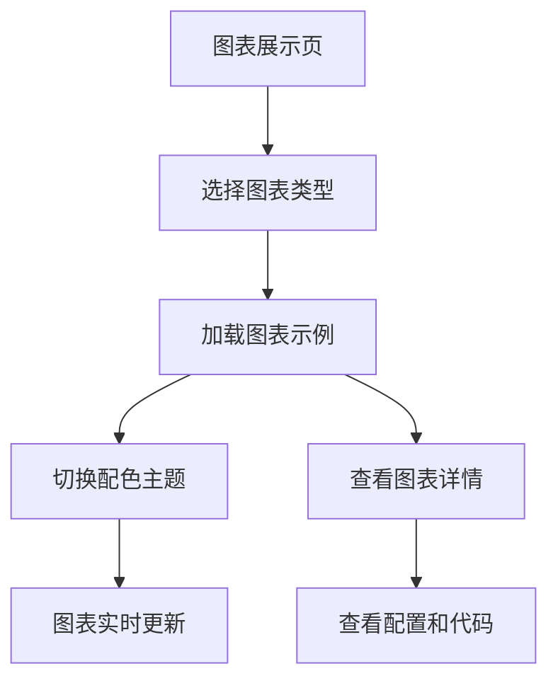

## 1. 产品概述
图表组件库是一套完整的可视化图表解决方案，提供9大类常用图表类型，支持3种可切换的全局配色风格。通过左侧导航栏快速切换图表展示，为数据可视化项目提供即用型组件。

## 2. 核心功能

### 2.1 用户角色
| 角色 | 注册方式 | 核心权限 |
|------|----------|----------|
| 访客用户 | 无需注册 | 浏览所有图表示例，切换配色主题 |

### 2.2 功能模块
图表组件库包含以下主要页面：
1. **图表展示页**：左侧导航栏、图表展示区域、配色主题切换器
2. **图表详情页**：单个图表的详细配置和代码示例

### 2.3 页面详情
| 页面名称 | 模块名称 | 功能描述 |
|----------|----------|----------|
| 图表展示页 | 左侧导航栏 | 显示9大类图表菜单，支持点击切换不同图表类型 |
| 图表展示页 | 图表展示区域 | 展示选中图表类型的多个示例，包含完整图表要素 |
| 图表展示页 | 配色主题切换器 | 提供3种配色风格切换按钮，全局实时生效 |
| 图表展示页 | 图表交互 | 支持hover高亮、点击选中、数据提示等交互 |
| 图表详情页 | 图表配置 | 显示当前图表的配置选项和参数说明 |
| 图表详情页 | 代码示例 | 提供图表组件的使用代码和API文档 |

## 3. 核心流程
用户访问图表展示页，通过左侧导航选择图表类型，系统自动加载对应图表示例。用户可通过顶部配色切换器实时切换3种配色主题，所有图表即时更新配色方案。

## 4. 用户界面设计

### 4.1 设计风格
- **主色调**：根据选定的配色主题动态变化
- **辅色调**：支持3种预设配色方案
- **按钮样式**：圆角矩形，支持hover和active状态
- **字体**：系统默认字体，标题16px，正文14px
- **布局**：左侧固定导航栏，右侧内容区域
- **图标**：简洁线性图标，hover时填充

### 4.2 页面设计
| 页面名称 | 模块名称 | UI元素 |
|----------|----------|--------|
| 图表展示页 | 左侧导航栏 | 宽度240px，深色背景，图标+文字菜单项，选中项高亮显示 |
| 图表展示页 | 图表展示区域 | 网格布局，每个图表卡片包含标题、图表、图例，支持响应式排列 |
| 图表展示页 | 配色主题切换器 | 顶部工具栏位置，3个圆形色块按钮，显示当前选中状态 |
| 图表详情页 | 图表配置面板 | 右侧抽屉式面板，包含配置表单和实时预览 |
| 图表详情页 | 代码示例区 | 语法高亮的代码块，支持一键复制功能 |

### 4.3 响应式设计
采用桌面端优先设计，适配1200px以上屏幕。移动端适配时左侧导航变为顶部标签栏，图表网格变为单列布局。

### 4.4 配色方案
提供3种专业配色主题，每种主题包含8-10个颜色用于图表数据系列：

**商务蓝调**
- 主色：#2E86AB
- 辅色：#A23B72、#F18F01、#C73E1D、#6BCF7F
- 中性色：#F8F9FA、#495057、#6C757D、#343A40

**活力橙系**
- 主色：#FF6B35
- 辅色：#F7931E、#FFD23F、#06FFA5、#3BCEAC
- 中性色：#FFFFFF、#2C3E50、#95A5A6、#1A1A1A

**清新绿境**
- 主色：#4CAF50
- 辅色：#8BC34A、#CDDC39、#009688、#00BCD4
- 中性色：#FAFAFA、#424242、#757575、#212121