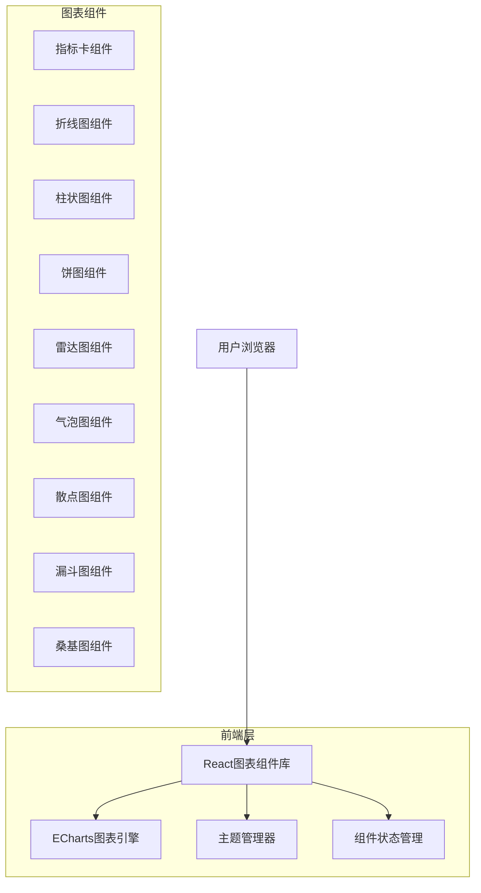

## 1. 架构设计



## 2. 技术描述

- **前端**：React@18 + TypeScript + Vite
- **图表引擎**：ECharts@5
- **样式方案**：CSS Modules + PostCSS
- **状态管理**：React Context + useReducer
- **初始化工具**：vite-init
- **后端**：无（纯前端组件库）

## 3. 路由定义

| 路由 | 用途 |
|------|------|
| / | 图表展示首页，显示所有图表类型 |
| /chart/:type | 特定图表类型详情页，展示配置和代码 |

## 4. 组件架构

### 4.1 核心组件结构
```typescript
interface ChartComponentProps {
  data: ChartData[];
  config: ChartConfig;
  theme: ColorTheme;
  onHover?: (data: ChartData) => void;
  onClick?: (data: ChartData) => void;
}

interface ChartConfig {
  title: string;
  xAxis?: AxisConfig;
  yAxis?: AxisConfig;
  legend?: LegendConfig;
  tooltip?: TooltipConfig;
  animation?: boolean;
}

interface ColorTheme {
  name: string;
  colors: string[];
  background: string;
  textColor: string;
  gridColor: string;
}
```

### 4.2 图表组件分类
- **指标组件**：KPIIndicator、FlipCounter、Gauge、ProgressBar、LiquidChart
- **线性图表**：LineChart、SmoothLineChart、MultiLineChart、AreaChart、StackedAreaChart
- **柱状图表**：BarChart、HorizontalBarChart、GroupedBarChart、StackedBarChart
- **饼环图表**：PieChart、DonutChart、RoseChart
- **其他图表**：RadarChart、BubbleChart、ScatterChart、FunnelChart、SankeyChart

## 5. 主题系统

### 5.1 主题配置
```typescript
const themes = {
  business: {
    name: '商务蓝调',
    colors: ['#2E86AB', '#A23B72', '#F18F01', '#C73E1D', '#6BCF7F'],
    background: '#F8F9FA',
    textColor: '#343A40',
    gridColor: '#DEE2E6'
  },
  vibrant: {
    name: '活力橙系',
    colors: ['#FF6B35', '#F7931E', '#FFD23F', '#06FFA5', '#3BCEAC'],
    background: '#FFFFFF',
    textColor: '#2C3E50',
    gridColor: '#ECF0F1'
  },
  fresh: {
    name: '清新绿境',
    colors: ['#4CAF50', '#8BC34A', '#CDDC39', '#009688', '#00BCD4'],
    background: '#FAFAFA',
    textColor: '#424242',
    gridColor: '#E0E0E0'
  }
};
```

### 5.2 主题切换机制
使用React Context实现全局主题管理，支持实时切换和持久化存储。

## 6. 交互状态管理

### 6.1 状态定义
- **默认状态**：正常显示图表数据
- **悬停状态**：高亮当前数据项，显示详细提示
- **点击状态**：选中数据项，触发相关事件
- **禁用状态**：图表不可交互，视觉置灰

### 6.2 事件处理
```typescript
interface ChartEvents {
  onMouseEnter?: (event: MouseEvent, data: any) => void;
  onMouseLeave?: (event: MouseEvent, data: any) => void;
  onClick?: (event: MouseEvent, data: any) => void;
  onDoubleClick?: (event: MouseEvent, data: any) => void;
}
```

## 7. 性能优化

- **懒加载**：按需加载图表组件
- **虚拟化**：大数据量时启用虚拟滚动
- **缓存**：相同配置图表使用缓存实例
- **防抖**：频繁交互事件使用防抖处理