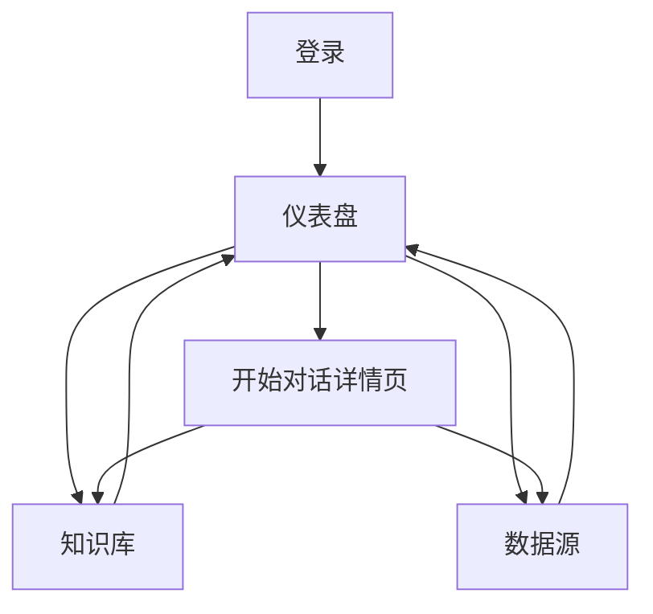

## 1. Product Overview
ChatBI 后台系统以“对话 + 指标知识”方式帮助你快速获得数据洞察。
提供 Ant Design 专业风格界面与左侧多层级导航，并支持深色主题切换与多语言切换，核心覆盖仪表盘、知识库与数据源管理。

## 2. Core Features

### 2.1 User Roles (selectively add based on user needs)
本版本不区分用户角色（默认单一使用者体验）。

### 2.2 Feature Module
系统需求由以下主要页面构成：
1. **登录**：账号登录、登录态校验与跳转。
2. **仪表盘**：核心指标概览、趋势/分布图表、对话式查询入口、结果概览（图表/表格切换）与对话详情跳转。
3. **开始对话详情页**：完整对话交互（继续追问/重试）、结果展示（图表/表格切换）、查看 SQL、导出结果、Mock 对话数据。
4. **知识库**：知识条目列表（分类与搜索）、条目创建/编辑、条目详情查看（用于对话/分析提示）。
5. **数据源**：数据源列表、数据源新增/编辑（连接信息）、连接测试与可用性状态、基础元信息预览。

### 2.3 Page Details
| Page Name | Module Name | Feature description |
|-----------|-------------|---------------------|
| 全局（所有页面） | 应用外壳（Layout） | 提供 Ant Design 专业风格布局：左侧多层级导航（支持折叠）+ 顶部栏（页面标题/面包屑可选）。在顶部栏提供：主题切换（浅色/深色）与语言切换（多语言），并在刷新后保持你的选择（本地持久化）。 |
| 登录 | 表单登录 | 输入账号信息并登录；登录成功后跳转到仪表盘；登录失败提示原因。 |
| 仪表盘 | 全局布局与导航 | 通过全局应用外壳进入仪表盘模块，并在内容区展示概览与对话查询相关信息。 |
| 仪表盘 | 指标概览 | 展示关键指标卡片（如本日/本周核心指标），支持基础刷新。 |
| 仪表盘 | 可视化概览 | 展示趋势/分布等图表区域，用于承载 BI 概览结果。 |
| 仪表盘 | 对话式查询（概览） | 输入自然语言问题并提交；展示对话记录与本次结果概览（文字结论 + 图表/表格切换）；提供进入「开始对话详情页」继续追问入口。 |
| 仪表盘 | 仪表盘关联表 | 在图表下方展示与当前图表同口径的明细表（用于解释图表），并与图表切换保持一致。 |
| 仪表盘 | 快捷入口 | 提供跳转到知识库与数据源的入口按钮/卡片。 |
| 开始对话详情页 | 对话交互 | 展示完整消息流；继续追问并追加消息；支持对单条提问执行重试（重新生成结果）。 |
| 开始对话详情页 | 结果展示 | 展示结论文本；支持图表/表格切换；在结果超出容器时提供可滚动预览（水平/垂直滚动条可见）。 |
| 开始对话详情页 | 查看 SQL | 展示本次生成/执行的 SQL（只读）；支持复制。 |
| 开始对话详情页 | 导出 | 将当前结果导出（如 CSV）；导出前校验是否有可导出表格数据。 |
| 开始对话详情页 | Mock 对话数据 | 一键注入示例对话与示例结果（用于演示/空态引导），并可清空恢复。 |
| 知识库 | 条目列表与筛选 | 按分类/关键词搜索并列表展示条目；展示条目标题、分类、更新时间。 |
| 知识库 | 条目创建/编辑 | 新建或编辑条目内容；支持保存与取消。 |
| 知识库 | 条目详情 | 查看条目全文与元信息（分类/标签等）；提供进入编辑的入口。 |
| 数据源 | 数据源列表 | 展示已配置数据源列表；展示名称、类型、状态、更新时间；提供新增入口。 |
| 数据源 | 数据源新增/编辑 | 录入/修改连接信息（如主机、端口、库名、账号等必要字段）；保存与取消。 |
| 数据源 | 连接测试与状态 | 执行连接测试并回显成功/失败原因；在列表中展示可用性状态。 |
| 数据源 | 元信息预览 | 在连接可用时预览基础元信息（如 schema / 表列表的只读摘要）。 |

## 3. Core Process
**主流程（通用）**
1) 你打开系统，未登录则进入「登录」完成身份验证后跳转「仪表盘」。
2) 你在「仪表盘-对话式查询」输入问题并提交，系统返回结论文本与结果概览（图表/表格切换）。
3) 你点击“进入详情/继续对话”进入「开始对话详情页」，继续追问并查看完整上下文；在需要时打开“查看 SQL”，或将结果“导出”。
4) 当你需要补充口径或知识提示时，进入「知识库」搜索并创建/编辑条目，再返回「仪表盘/开始对话详情页」继续提问。
5) 当对话查询需要新增或修复数据连接时，进入「数据源」新增/编辑并测试连接，状态正常后返回继续分析。

