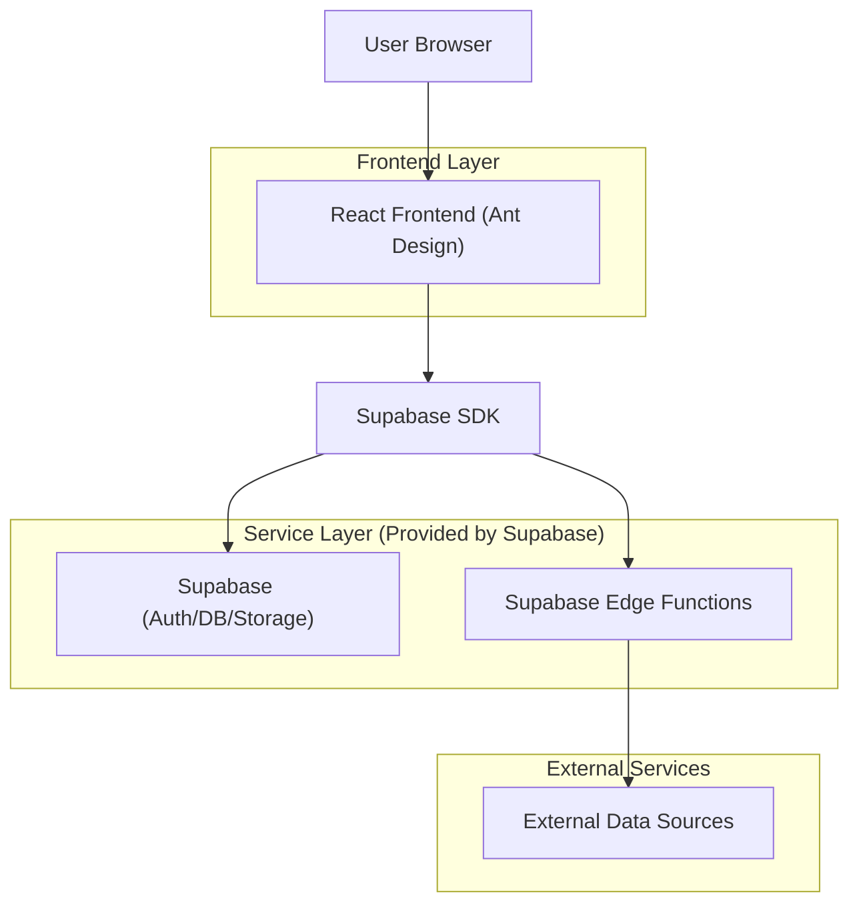
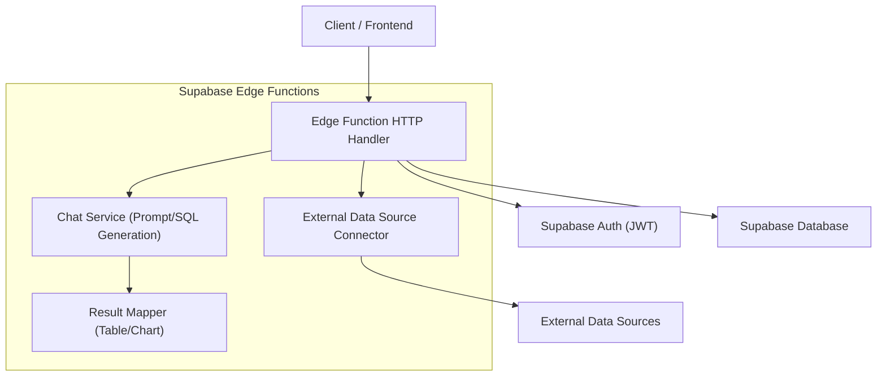
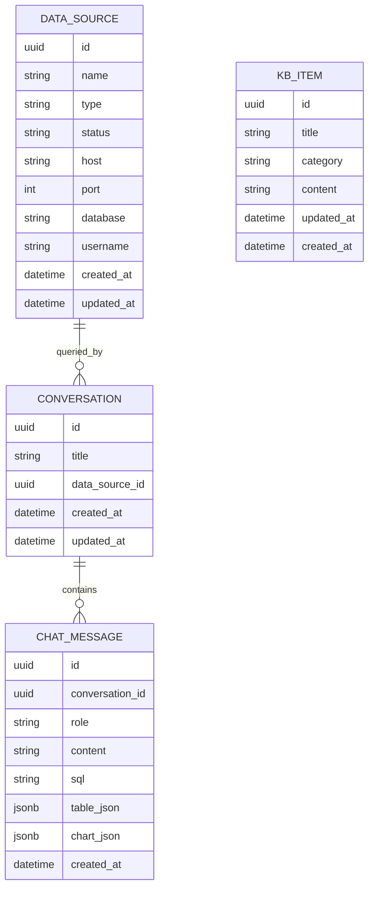

## 1.Architecture design


## 2.Technology Description
- Frontend: React@18 + TypeScript + Ant Design@5 + vite + react-router + i18next/react-i18next
- Backend: Supabase (Auth + PostgreSQL + Edge Functions)
- Database: Supabase (PostgreSQL)

## 3.Route definitions
| Route | Purpose |
|-------|---------|
| / | 根路由：重定向到 /dashboard 或 /login（取决于登录态） |
| /login | 登录页：完成身份验证并建立会话 |
| /dashboard | 仪表盘：指标概览、可视化区域、对话式查询入口与结果概览（图表/表格切换） |
| /chat/:conversationId | 开始对话详情页：完整对话交互、结果展示、查看 SQL、导出 |
| /knowledge-base | 知识库：条目列表、搜索筛选、条目创建/编辑、条目详情 |
| /data-sources | 数据源：列表、新增/编辑、连接测试、元信息预览 |

## 4.API definitions (If it includes backend services)
### 4.1 TypeScript shared types
```ts
export type Id = string;

export type DataSourceType = 'postgres' | 'mysql' | 'other';

export type DataSourceStatus = 'unknown' | 'ok' | 'error';

export interface DataSource {
  id: Id;
  name: string;
  type: DataSourceType;
  status: DataSourceStatus;
  // 连接字段为最小必要集；敏感字段仅存服务端
  host: string;
  port: number;
  database: string;
  username: string;
  createdAt: string;
  updatedAt: string;
}

export interface KnowledgeBaseItem {
  id: Id;
  title: string;
  category: string;
  content: string;
  updatedAt: string;
}

export interface ChatQueryRequest {
  question: string;
  // 可选：用于与“知识库条目”做关联提示
  kbItemIds?: Id[];
  dataSourceId?: Id;
  // 可选：继续某个对话；仪表盘首次提问可不传
  conversationId?: Id;
}

export interface ChatQueryResponse {
  conversationId: Id;
  messageId: Id;
  answerText: string;
  // 便于“查看 SQL”与审计
  sql?: string;
  // 结果承载：表格与图表数据结构保持通用
  table?: { columns: string[]; rows: Array<Record<string, string | number | null>> };
  chart?: { type: 'line' | 'bar' | 'pie' | 'other'; data: unknown };
}

export interface Conversation {
  id: Id;
  title: string;
  createdAt: string;
  updatedAt: string;
}

export type ChatMessageRole = 'user' | 'assistant';

export interface ChatMessage {
  id: Id;
  conversationId: Id;
  role: ChatMessageRole;
  content: string;
  // 仅 assistant 消息可能附带
  sql?: string;
  createdAt: string;
}

export type ThemeMode = 'light' | 'dark';
export type LocaleCode = 'zh-CN' | 'en-US';

export interface UserPreference {
  userId: Id;
  theme: ThemeMode;
  locale: LocaleCode;
  updatedAt: string;
}
```

### 4.2 Core API（Supabase Edge Functions）
对话式查询（新建或继续对话）
```
POST /functions/v1/chat/query
```
Request:
| Param Name| Param Type  | isRequired  | Description |
|-----------|-------------|-------------|-------------|
| question  | string      | true        | 你输入的自然语言问题 |
| kbItemIds | string[]    | false       | 关联知识库条目 ID，用于提示 |
| dataSourceId | string   | false       | 指定数据源 ID |
| conversationId | string | false       | 继续既有对话 |

Response:
| Param Name| Param Type  | Description |
|-----------|-------------|-------------|
| conversationId | string | 对话 ID |
| messageId | string | 本次 assistant 消息 ID |
| answerText | string | 分析结论文本 |
| sql | string | 可选：生成/执行 SQL（用于“查看 SQL”） |
| table | object | 可选表格结果 |
| chart | object | 可选图表结果 |

获取对话详情（用于“开始对话详情页”首屏加载）
```
GET /functions/v1/conversations/:conversationId
```

导出当前结果（导出当前 messageId 对应结果；前端可选择直接导出 table）
```
GET /functions/v1/messages/:messageId/export?format=csv
```

知识库
```
GET  /api/kb/items
POST /api/kb/items
GET  /api/kb/items/:id
PUT  /api/kb/items/:id
```

数据源
```
GET  /api/data-sources
POST /api/data-sources
PUT  /api/data-sources/:id
POST /api/data-sources/:id/test
GET  /api/data-sources/:id/metadata
```

## 5.Server architecture diagram (Edge Functions)


## 6.Data model(if applicable)
### 6.1 Data model definition


### 6.2 Data Definition Language
Data sources (data_sources)
```
CREATE TABLE data_sources (
  id UUID PRIMARY KEY DEFAULT gen_random_uuid(),
  name TEXT NOT NULL,
  type TEXT NOT NULL,
  status TEXT NOT NULL DEFAULT 'unknown',
  host TEXT NOT NULL,
  port INT NOT NULL,
  database TEXT NOT NULL,
  username TEXT NOT NULL,
  created_at TIMESTAMPTZ NOT NULL DEFAULT NOW(),
  updated_at TIMESTAMPTZ NOT NULL DEFAULT NOW()
);

GRANT SELECT ON data_sources TO anon;
GRANT ALL PRIVILEGES ON data_sources TO authenticated;
```

Knowledge base items (kb_items)
```
CREATE TABLE kb_items (
  id UUID PRIMARY KEY DEFAULT gen_random_uuid(),
  title TEXT NOT NULL,
  category TEXT NOT NULL,
  content TEXT NOT NULL,
  created_at TIMESTAMPTZ NOT NULL DEFAULT NOW(),
  updated_at TIMESTAMPTZ NOT NULL DEFAULT NOW()
);

CREATE INDEX idx_kb_items_category ON kb_items(category);
CREATE INDEX idx_kb_items_updated_at ON kb_items(updated_at DESC);

GRANT SELECT ON kb_items TO anon;
GRANT ALL PRIVILEGES ON kb_items TO authenticated;
```

Conversations (conversations)
```
CREATE TABLE conversations (
  id UUID PRIMARY KEY DEFAULT gen_random_uuid(),
  title TEXT NOT NULL,
  data_source_id UUID,
  created_at TIMESTAMPTZ NOT NULL DEFAULT NOW(),
  updated_at TIMESTAMPTZ NOT NULL DEFAULT NOW()
);

CREATE INDEX idx_conversations_updated_at ON conversations(updated_at DESC);

GRANT SELECT ON conversations TO anon;
GRANT ALL PRIVILEGES ON conversations TO authenticated;
```

Chat messages (chat_messages)
```
CREATE TABLE chat_messages (
  id UUID PRIMARY KEY DEFAULT gen_random_uuid(),
  conversation_id UUID NOT NULL,
  role TEXT NOT NULL,
  content TEXT NOT NULL,
  sql TEXT,
  table_json JSONB,
  chart_json JSONB,
  created_at TIMESTAMPTZ NOT NULL DEFAULT NOW()
);

CREATE INDEX idx_chat_messages_conversation_id ON chat_messages(conversation_id);
CREATE INDEX idx_chat_messages_created_at ON chat_messages(created_at);

GRANT SELECT ON chat_messages TO anon;
GRANT ALL PRIVILEGES ON chat_messages TO authenticated;
```

User preferences (user_preferences)
```
CREATE TABLE user_preferences (
  id UUID PRIMARY KEY DEFAULT gen_random_uuid(),
  user_id UUID NOT NULL,
  theme TEXT NOT NULL DEFAULT 'light',
  locale TEXT NOT NULL DEFAULT 'zh-CN',
  updated_at TIMESTAMPTZ NOT NULL DEFAULT NOW()
);

CREATE INDEX idx_user_preferences_user_id ON user_preferences(user_id);

GRANT SELECT ON user_preferences TO anon;
GRANT ALL PRIVILEGES ON user_preferences TO authenticated;
```
