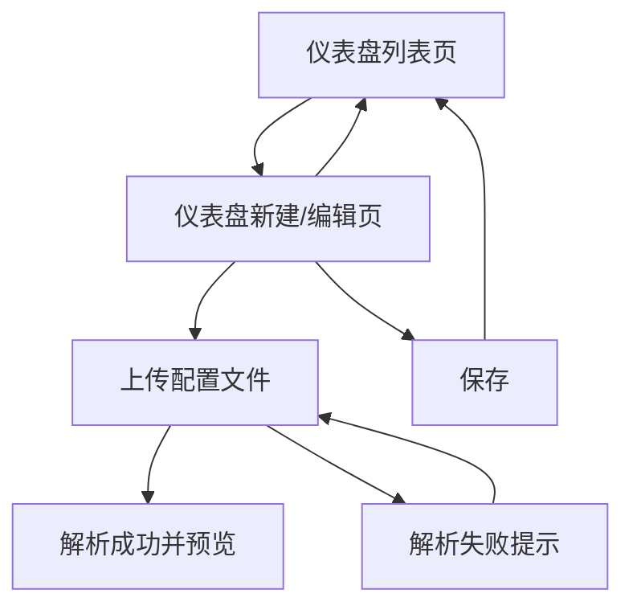

## 1. Product Overview
为「仪表盘新建/编辑」流程补齐主题色驱动的视觉与布局联动，并支持上传配置文件的预览与解析失败交互。
面向需要快速配置并调整仪表盘样式与布局的使用者，降低配置出错与返工成本。

## 2. Core Features

### 2.1 Feature Module
本次需求包含以下核心页面：
1. **仪表盘列表页**：入口与导航、新建入口、编辑入口。
2. **仪表盘新建/编辑页**：主题色选择与联动预览、布局区域随主题色变化、上传配置文件预览与解析失败处理。

### 2.2 Page Details
| Page Name | Module Name | Feature description |
|-----------|-------------|---------------------|
| 仪表盘列表页 | 列表与操作入口 | 展示仪表盘列表；提供“新建仪表盘”入口；每个仪表盘提供“编辑”入口。 |
| 仪表盘新建/编辑页 | 基础信息区 | 选择主题色（移除封面相关入口与展示）；保存时持久化主题色。 |
| 仪表盘新建/编辑页 | 主题色联动预览 | 根据主题色实时更新页面关键元素样式（如标题、按钮主色、卡片强调色等）；预览区域与编辑表单保持同步。 |
| 仪表盘新建/编辑页 | 布局编辑区 | 布局编辑/展示区域的背景、分隔线、选中态等与主题色联动（遵循可读性对比度规则）。 |
| 仪表盘新建/编辑页 | 配置文件上传与预览 | 上传配置文件后立即展示“解析后的预览”（例如结构/模块概览）；允许重新上传覆盖当前文件。 |
| 仪表盘新建/编辑页 | 解析失败交互 | 解析失败时展示明确错误状态与原因摘要；保留上一次成功预览（若有）或展示空态；提供“重新上传/重试”入口。 |
| 仪表盘新建/编辑页 | 保存与离开保护 | 保存仪表盘配置；离开页面时对未保存变更进行提示（含主题色与配置文件变更）。 |

## 3. Core Process
**新建流程**：你从仪表盘列表页进入新建页 → 选择主题色 →（可选）上传配置文件并在右侧/下方看到解析预览 → 若解析失败则看到错误提示并可重试/重新上传 → 确认预览与主题色效果 → 保存成功后回到列表页或停留继续编辑。

**编辑流程**：你从仪表盘列表页进入编辑页 → 页面加载已保存的主题色与上次成功解析的预览结果 → 你修改主题色会实时影响布局与预览 →（可选）重新上传配置文件并预览 → 保存覆盖原配置。

