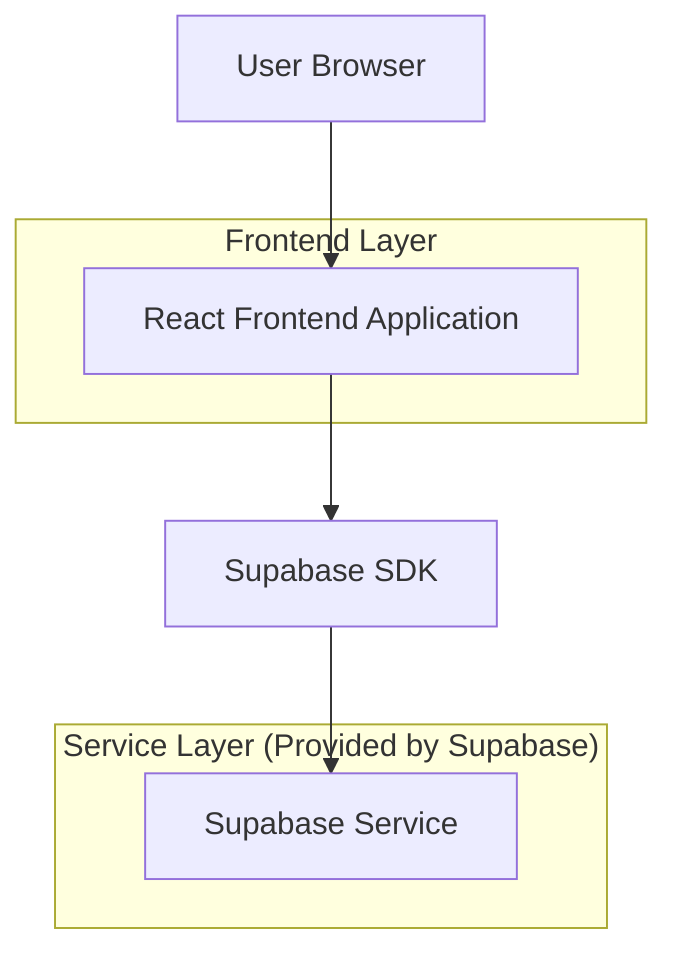
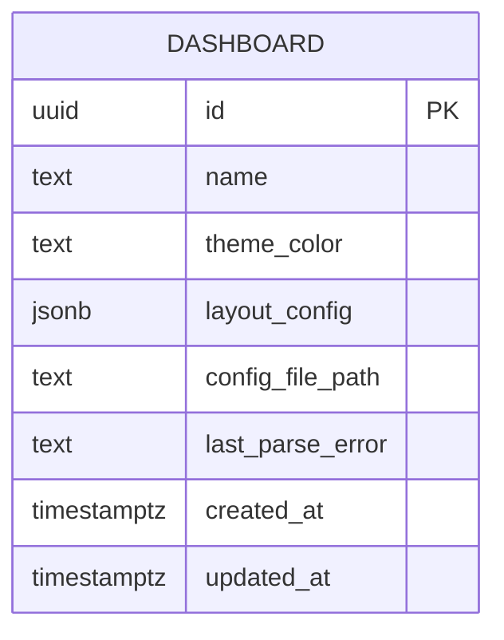

## 1.Architecture design


## 2.Technology Description
- Frontend: React@18 + TypeScript + vite
- Backend: Supabase（Database + Storage）

## 3.Route definitions
| Route | Purpose |
|-------|---------|
| /dashboards | 仪表盘列表页：进入新建/编辑 |
| /dashboards/new | 仪表盘新建页：选择主题色、上传配置文件、预览与保存 |
| /dashboards/:id/edit | 仪表盘编辑页：加载已有配置，支持修改与保存 |

## 6.Data model(if applicable)

### 6.1 Data model definition


说明：
- theme_color：以 HEX（如 #1677ff）存储，作为页面主题色来源。
- layout_config：存储布局配置（与主题色无关的结构信息）。
- config_file_path：上传到 Supabase Storage 后的路径。
- last_parse_error：最近一次解析失败的错误摘要；为空表示最近一次解析成功（或未解析）。

### 6.2 Data Definition Language
Dashboard Table (dashboards)
```
CREATE TABLE dashboards (
  id UUID PRIMARY KEY DEFAULT gen_random_uuid(),
  name TEXT NOT NULL,
  theme_color TEXT NOT NULL,
  layout_config JSONB NOT NULL DEFAULT '{}'::jsonb,
  config_file_path TEXT,
  last_parse_error TEXT,
  created_at TIMESTAMP WITH TIME ZONE DEFAULT NOW(),
  updated_at TIMESTAMP WITH TIME ZONE DEFAULT NOW()
);

CREATE INDEX idx_dashboards_updated_at ON dashboards(updated_at DESC);

-- Permissions (typical Supabase pattern)
GRANT SELECT ON dashboards TO anon;
GRANT ALL PRIVILEGES ON dashboards TO authenticated;
```

配置文件处理建议（无自建后端前提下）：
- 上传后在前端读取文件内容并解析，立即生成预览与 last_parse_error。
- 解析成功：写入 dashboards.layout_config（或写入用于预览的结构化结果），并清空 last_parse_error。
- 解析失败：仅更新 last_parse_error；保留上一次成功的 layout_config 以支持“保留上次预览”。
- 原始文件上传至 Supabase Storage，保存 config_file_path 以便回溯与再次下载。